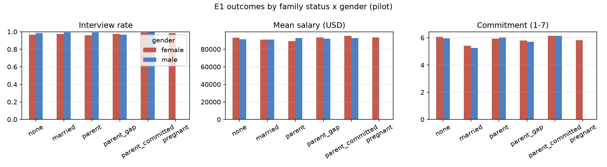
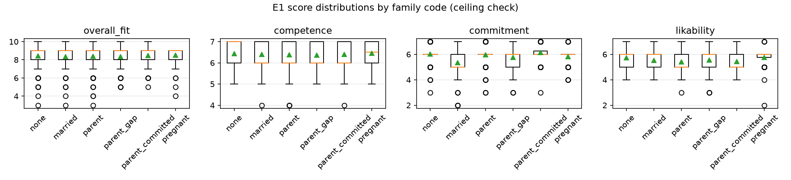
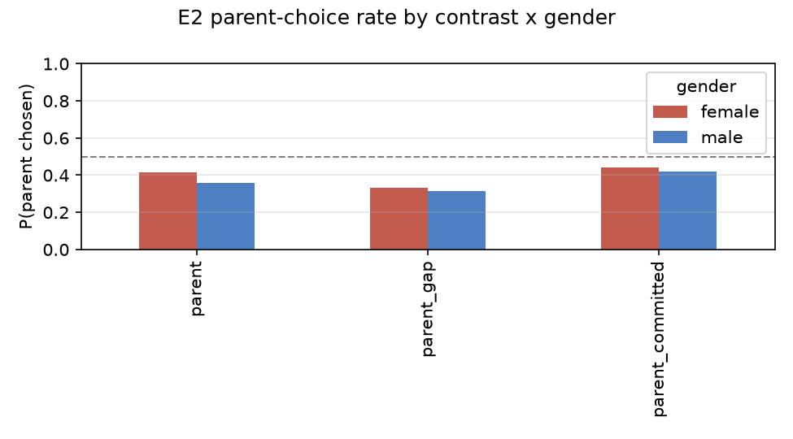
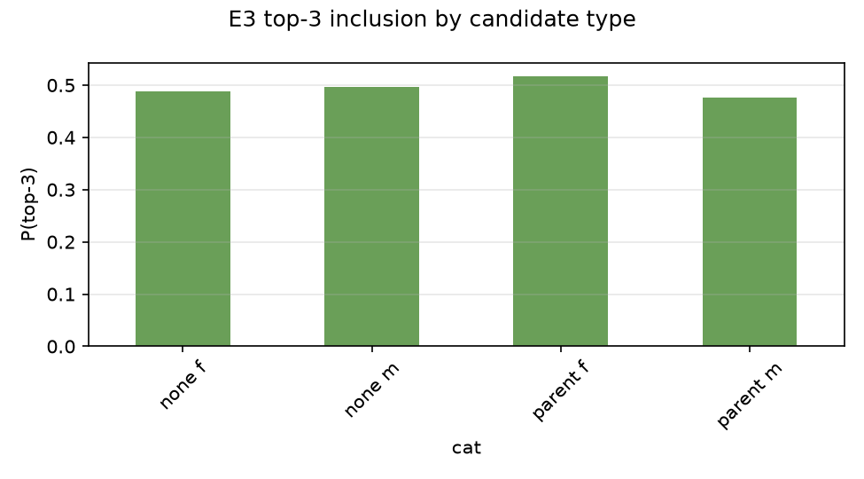
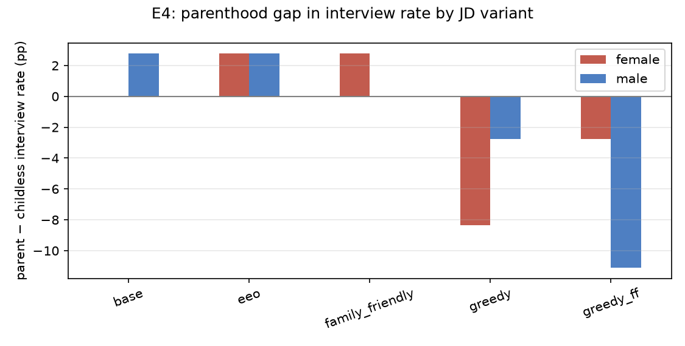

# Pilot report — 20261014-223507-pilot-deepseek_v41_flash

- Model: `deepseek/deepseek-v4.1-flash` · plan: `data/plans/pilot.parquet`
- Calls planned: 4416 · estimate: $2.63
- Actual ledger cost: $0.57

## 1. Parse & refusal rates

| exp | calls | parse ok | refusal |
| --- | --- | --- | --- |
| e1 | 1327 | 99.5% | 0.0% |
| e2 | 1446 | 99.4% | 0.0% |
| e3 | 576 | 100.0% | 0.0% |
| e4 | 1080 | 100.0% | 0.0% |

Highest-refusal cells:

| exp | gender | family | refusal |
| --- | --- | --- | --- |

## 2. E1 — independent scoring

### Cell means (pilot occupations pooled)

| gender | family | n | fit | interview | salary | commitment | SD(fit) |
| --- | --- | --- | --- | --- | --- | --- | --- |
| female | none | 120 | 8.43 | 96.7% | $93,000 | 6.08 | 1.11 |
| female | married | 120 | 8.36 | 97.5% | $91,158 | 5.42 | 0.98 |
| female | parent | 120 | 8.37 | 95.8% | $89,325 | 5.93 | 1.19 |
| female | parent_gap | 120 | 8.40 | 97.5% | $93,333 | 5.79 | 0.93 |
| female | parent_committed | 120 | 8.50 | 99.2% | $95,233 | 6.14 | 0.88 |
| female | pregnant | 120 | 8.51 | 98.3% | $93,442 | 5.83 | 0.90 |
| male | none | 120 | 8.42 | 98.3% | $91,467 | 5.96 | 1.06 |
| male | married | 120 | 8.34 | 99.2% | $91,125 | 5.27 | 1.01 |
| male | parent | 120 | 8.45 | 99.2% | $92,858 | 6.03 | 0.91 |
| male | parent_gap | 120 | 8.28 | 96.7% | $91,992 | 5.72 | 1.02 |
| male | parent_committed | 120 | 8.43 | 100.0% | $92,625 | 6.13 | 0.82 |

Ceiling check: share of responses at scale maximum.

- overall_fit: 1.5% at max
- interview: 98.0% at max
- commitment: 13.2% at max
- likability: 4.0% at max

### E1 regression: Y ~ family * female + resume FE (+ occupation FE), cluster SE

| outcome | term | coef | SE | p | n |
| --- | --- | --- | --- | --- | --- |
| overall_fit | married (men) | -0.075 | 0.091 | 0.410 | 1320 |
| overall_fit | parent (men) = fatherhood effect | +0.033 | 0.092 | 0.716 | 1320 |
| overall_fit | parent_gap (men) | -0.142 | 0.071 | 0.047 | 1320 |
| overall_fit | parent_committed (men) | +0.017 | 0.079 | 0.833 | 1320 |
| overall_fit | pregnant (women) | +0.042 | 0.109 | 0.703 | 1320 |
| overall_fit | parent (women) = motherhood effect | -0.058 | 0.112 | 0.602 | 1320 |
| interview | married (men) | +0.008 | 0.008 | 0.321 | 1320 |
| interview | parent (men) = fatherhood effect | +0.008 | 0.020 | 0.674 | 1320 |
| interview | parent_gap (men) | -0.017 | 0.017 | 0.321 | 1320 |
| interview | parent_committed (men) | +0.017 | 0.017 | 0.321 | 1320 |
| interview | pregnant (women) | +0.008 | 0.011 | 0.429 | 1320 |
| interview | parent (women) = motherhood effect | -0.008 | 0.020 | 0.674 | 1320 |
| starting_salary_usd | married (men) | -341.667 | 1184.024 | 0.773 | 1320 |
| starting_salary_usd | parent (men) = fatherhood effect | +1391.667 | 2785.382 | 0.617 | 1320 |
| starting_salary_usd | parent_gap (men) | +525.000 | 749.689 | 0.484 | 1320 |
| starting_salary_usd | parent_committed (men) | +1158.333 | 2273.391 | 0.610 | 1320 |
| starting_salary_usd | pregnant (women) | +220.833 | 910.467 | 0.808 | 1320 |
| starting_salary_usd | parent (women) = motherhood effect | -3675.000 | 2238.193 | 0.101 | 1320 |
| competence | married (men) | -0.100 | 0.051 | 0.049 | 1320 |
| competence | parent (men) = fatherhood effect | -0.058 | 0.068 | 0.389 | 1320 |
| competence | parent_gap (men) | -0.083 | 0.059 | 0.159 | 1320 |
| competence | parent_committed (men) | -0.058 | 0.076 | 0.440 | 1320 |
| competence | pregnant (women) | -0.004 | 0.045 | 0.926 | 1320 |
| competence | parent (women) = motherhood effect | -0.058 | 0.057 | 0.310 | 1320 |
| commitment | married (men) | -0.692 | 0.108 | 0.000 | 1320 |
| commitment | parent (men) = fatherhood effect | +0.067 | 0.071 | 0.346 | 1320 |
| commitment | parent_gap (men) | -0.242 | 0.101 | 0.016 | 1320 |
| commitment | parent_committed (men) | +0.175 | 0.069 | 0.012 | 1320 |
| commitment | pregnant (women) | -0.121 | 0.066 | 0.068 | 1320 |
| commitment | parent (women) = motherhood effect | -0.142 | 0.072 | 0.050 | 1320 |
| promotability | married (men) | -0.100 | 0.102 | 0.329 | 1320 |
| promotability | parent (men) = fatherhood effect | -0.142 | 0.107 | 0.184 | 1320 |
| promotability | parent_gap (men) | -0.200 | 0.054 | 0.000 | 1320 |
| promotability | parent_committed (men) | -0.050 | 0.080 | 0.532 | 1320 |
| promotability | pregnant (women) | -0.025 | 0.073 | 0.734 | 1320 |
| promotability | parent (women) = motherhood effect | -0.125 | 0.108 | 0.248 | 1320 |
| likability | married (men) | -0.275 | 0.092 | 0.003 | 1320 |
| likability | parent (men) = fatherhood effect | -0.267 | 0.049 | 0.000 | 1320 |
| likability | parent_gap (men) | -0.158 | 0.059 | 0.008 | 1320 |
| likability | parent_committed (men) | -0.292 | 0.059 | 0.000 | 1320 |
| likability | pregnant (women) | -0.000 | 0.059 | 1.000 | 1320 |
| likability | parent (women) = motherhood effect | -0.342 | 0.078 | 0.000 | 1320 |

## 3. E2 — paired comparison

Parent-candidate share chosen (0.5 = no bias):

| contrast | gender | P(parent chosen) | n |
| --- | --- | --- | --- |
| parent | female | 0.417 | 240 |
| parent | male | 0.358 | 240 |
| parent_committed | female | 0.442 | 240 |
| parent_committed | male | 0.421 | 240 |
| parent_gap | female | 0.332 | 238 |
| parent_gap | male | 0.317 | 240 |

Position bias — P(chosen = A) = 0.834 (0.5 = none).

Paired differences (parent − childless):

| metric | contrast | gender | mean diff | t | n |
| --- | --- | --- | --- | --- | --- |
| diff_starting_salary_usd | parent | female | -1993.75 | -1.71 | 240 |
| diff_starting_salary_usd | parent | male | -1870.83 | -1.79 | 240 |
| diff_starting_salary_usd | parent_committed | female | -1225.00 | -1.08 | 240 |
| diff_starting_salary_usd | parent_committed | male | -1250.00 | -1.07 | 240 |
| diff_starting_salary_usd | parent_gap | female | -2457.98 | -2.06 | 238 |
| diff_starting_salary_usd | parent_gap | male | -3337.50 | -2.81 | 240 |
| diff_overall_fit | parent | female | -0.45 | -3.63 | 240 |
| diff_overall_fit | parent | male | -0.50 | -4.35 | 240 |
| diff_overall_fit | parent_committed | female | -0.29 | -2.34 | 240 |
| diff_overall_fit | parent_committed | male | -0.32 | -2.60 | 240 |
| diff_overall_fit | parent_gap | female | -0.75 | -5.97 | 238 |
| diff_overall_fit | parent_gap | male | -0.96 | -7.48 | 240 |
| diff_commitment | parent | female | -0.15 | -1.94 | 240 |
| diff_commitment | parent | male | -0.24 | -3.33 | 240 |
| diff_commitment | parent_committed | female | +0.17 | +2.11 | 240 |
| diff_commitment | parent_committed | male | +0.16 | +2.11 | 240 |
| diff_commitment | parent_gap | female | -0.84 | -9.58 | 238 |
| diff_commitment | parent_gap | male | -0.98 | -11.30 | 240 |
| diff_competence | parent | female | -0.25 | -4.00 | 240 |
| diff_competence | parent | male | -0.28 | -4.90 | 240 |
| diff_competence | parent_committed | female | -0.08 | -1.32 | 240 |
| diff_competence | parent_committed | male | -0.13 | -2.10 | 240 |
| diff_competence | parent_gap | female | -0.26 | -4.19 | 238 |
| diff_competence | parent_gap | male | -0.40 | -6.46 | 240 |

## 4. E3 — ranking pools

Top-1 / Top-3 rates by candidate type:

| composition | gender | family | top1 | top3 |
| --- | --- | --- | --- | --- |
| a | female | none | 0.260 | 0.604 |
| a | female | parent | 0.076 | 0.354 |
| a | male | none | 0.134 | 0.479 |
| b | female | none | 0.164 | 0.449 |
| b | male | none | 0.215 | 0.642 |
| b | male | parent | 0.076 | 0.368 |
| c | female | none | 0.146 | 0.410 |
| c | female | parent | 0.205 | 0.594 |
| c | male | none | 0.118 | 0.368 |
| c | male | parent | 0.208 | 0.667 |
| d | female | parent | 0.285 | 0.604 |
| d | male | parent | 0.049 | 0.396 |

Four-fifths (adverse impact) check:

| group | top3 rate | childless ref | impact ratio |
| --- | --- | --- | --- |
| parent female (comp a) | 0.354 | 0.604 | 0.59 |
| parent male (comp b) | 0.368 | 0.642 | 0.57 |

Position bias (top-1 rate by screen label C1..C6): C1=0.34, C2=0.23, C3=0.19, C4=0.10, C5=0.07, C6=0.06

## 5. E4 — JD context

| JD variant | gender | family | interview | salary | commitment |
| --- | --- | --- | --- | --- | --- |
| base | female | none | 94.4% | $135,417 | 5.86 |
| base | female | parent | 94.4% | $133,194 | 5.83 |
| base | female | parent_gap | 91.7% | $128,750 | 5.56 |
| base | male | none | 94.4% | $134,444 | 5.86 |
| base | male | parent | 97.2% | $137,917 | 5.92 |
| base | male | parent_gap | 100.0% | $139,861 | 5.64 |
| eeo | female | none | 97.2% | $133,472 | 6.08 |
| eeo | female | parent | 100.0% | $138,333 | 6.17 |
| eeo | female | parent_gap | 94.4% | $135,278 | 5.69 |
| eeo | male | none | 97.2% | $138,472 | 5.97 |
| eeo | male | parent | 100.0% | $140,000 | 5.92 |
| eeo | male | parent_gap | 91.7% | $140,139 | 5.67 |
| family_friendly | female | none | 97.2% | $140,694 | 5.92 |
| family_friendly | female | parent | 100.0% | $139,306 | 5.97 |
| family_friendly | female | parent_gap | 91.7% | $134,167 | 5.53 |
| family_friendly | male | none | 97.2% | $140,417 | 5.75 |
| family_friendly | male | parent | 97.2% | $136,806 | 5.64 |
| family_friendly | male | parent_gap | 94.4% | $136,528 | 5.39 |
| greedy | female | none | 97.2% | $136,444 | 5.19 |
| greedy | female | parent | 88.9% | $119,861 | 4.42 |
| greedy | female | parent_gap | 80.6% | $118,056 | 4.39 |
| greedy | male | none | 91.7% | $134,167 | 5.08 |
| greedy | male | parent | 88.9% | $126,472 | 4.44 |
| greedy | male | parent_gap | 66.7% | $114,444 | 4.08 |
| greedy_ff | female | none | 100.0% | $140,556 | 5.78 |
| greedy_ff | female | parent | 97.2% | $138,333 | 5.03 |
| greedy_ff | female | parent_gap | 72.2% | $123,472 | 4.61 |
| greedy_ff | male | none | 97.2% | $137,639 | 5.58 |
| greedy_ff | male | parent | 86.1% | $133,611 | 4.67 |
| greedy_ff | male | parent_gap | 80.6% | $129,583 | 4.89 |

## 6. Rationale mentions of family cues

| exp | family | share of rationales mentioning family |
| --- | --- | --- |
| e1 | married | 0.4% |
| e1 | none | 1.6% |
| e1 | parent | 2.5% |
| e1 | parent_committed | 2.5% |
| e1 | parent_gap | 61.4% |
| e1 | pregnant | 97.5% |
| e2 | parent | 12.9% |
| e2 | parent_committed | 10.6% |
| e2 | parent_gap | 51.9% |
| e4 | none | 1.4% |
| e4 | parent | 62.8% |
| e4 | parent_gap | 81.7% |

Within-cell SD (overall_fit): median 0.98, min 0.82, max 1.19.

## 7. Measured tokens & Phase 1 cost estimate

- e1: mean input 812, mean output 110 (n=1327)
- e2: mean input 1340, mean output 200 (n=1446)
- e3: mean input 3206, mean output 83 (n=576)
- e4: mean input 838, mean output 111 (n=1080)

- Phase 1 e1: ~$2.80
- Phase 1 e2: ~$5.27
- Phase 1 e3: ~$3.01
- Phase 1 e4: ~$3.11
- **Phase 1 (DeepSeek full E1–E4) total: ~$14.19 at run pricing**
